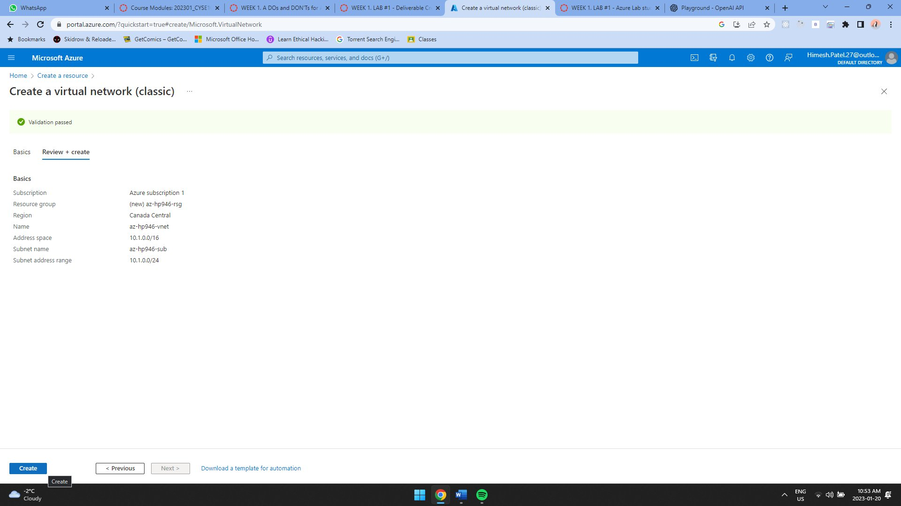
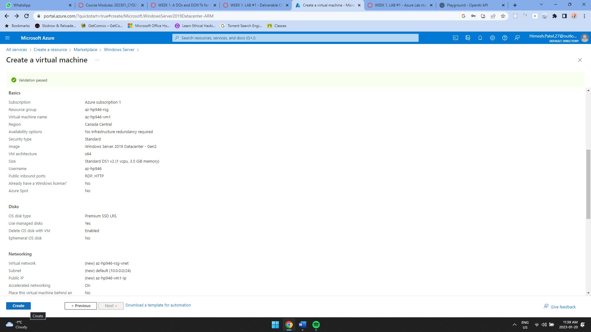
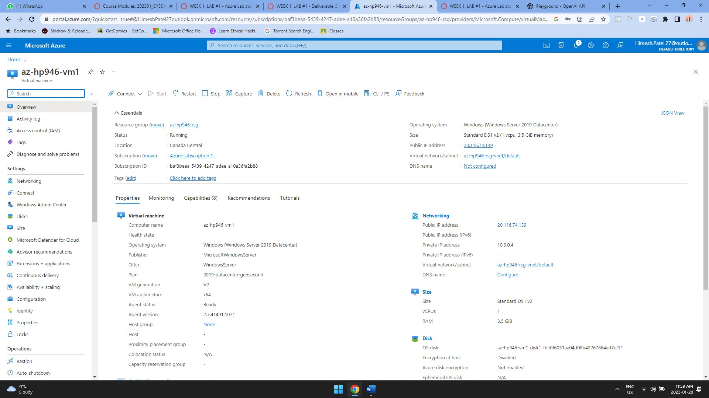
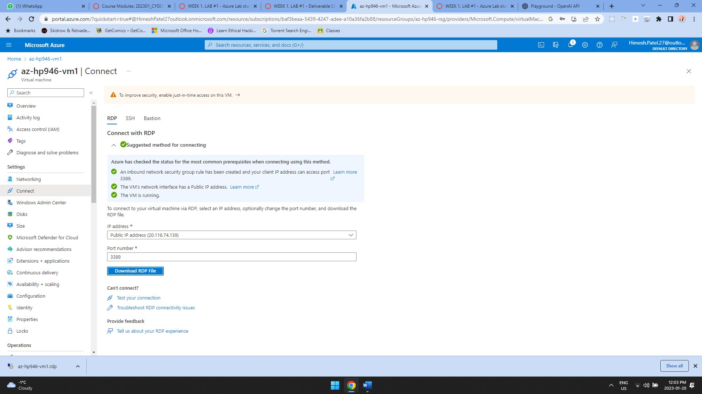
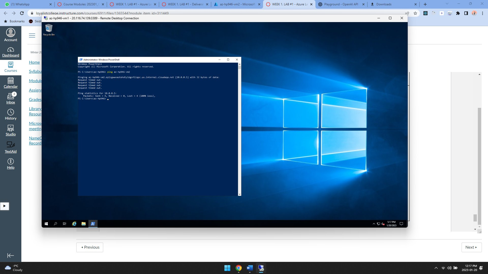
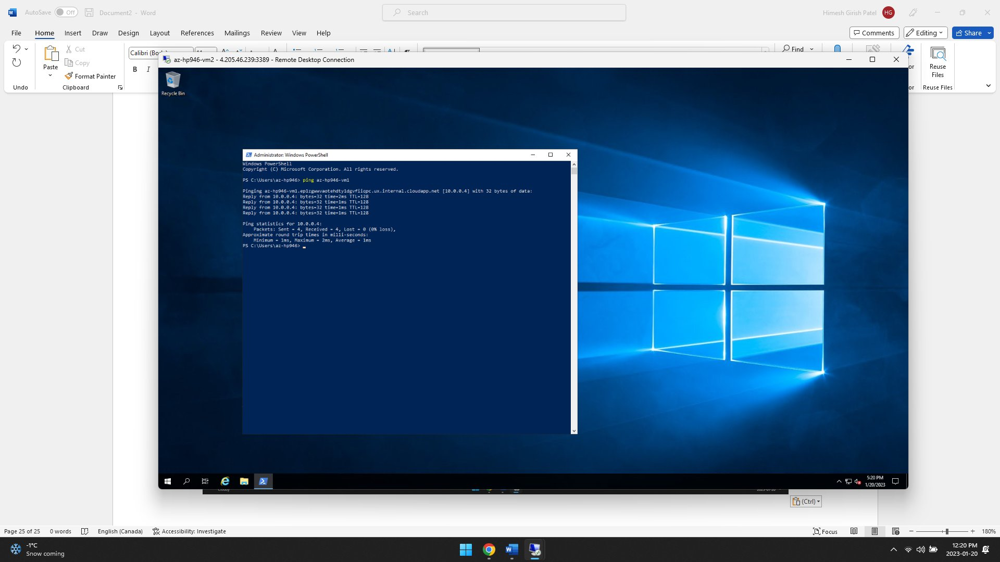

# Azure Virtual Network and Virtual Machine

## Overview
This guided college lab was my first hands-on exercise with Microsoft Azure. I used the Azure portal to create a virtual network and deploy a virtual machine, then connected to the VM to verify that the environment was working.

## Technologies Used
- Microsoft Azure
- Azure Virtual Network
- Azure Virtual Machines
- Windows / PowerShell

## What I Did
- Created and configured an Azure virtual network through the Azure portal.
- Created a virtual machine and reviewed its deployment and resource settings.
- Connected to the Windows VM and used PowerShell inside the deployed system.
- Verified the completed environment using the Azure portal and the VM session.

## Evidence
### Virtual network created

### VM deployment completed

### Virtual machine overview

### VM connection settings

### PowerShell inside the Windows VM

### Command verification in the VM

## Environment Note
The Azure resources used for this lab were temporary coursework resources and are no longer running to avoid ongoing cloud charges. The screenshots were captured while the lab environment was active.
