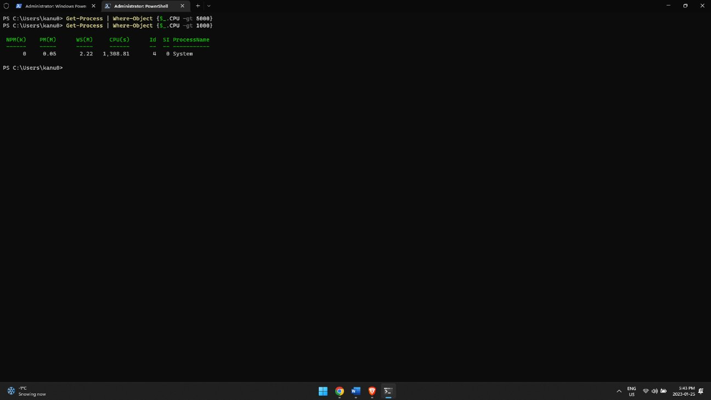
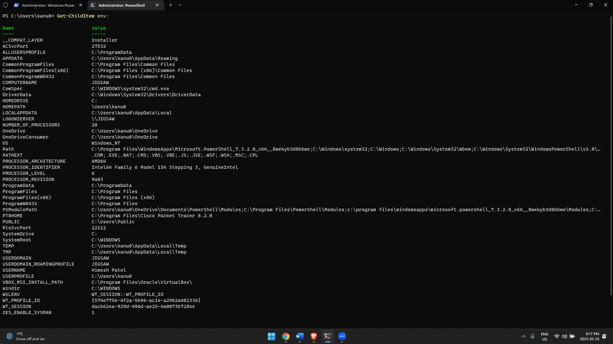
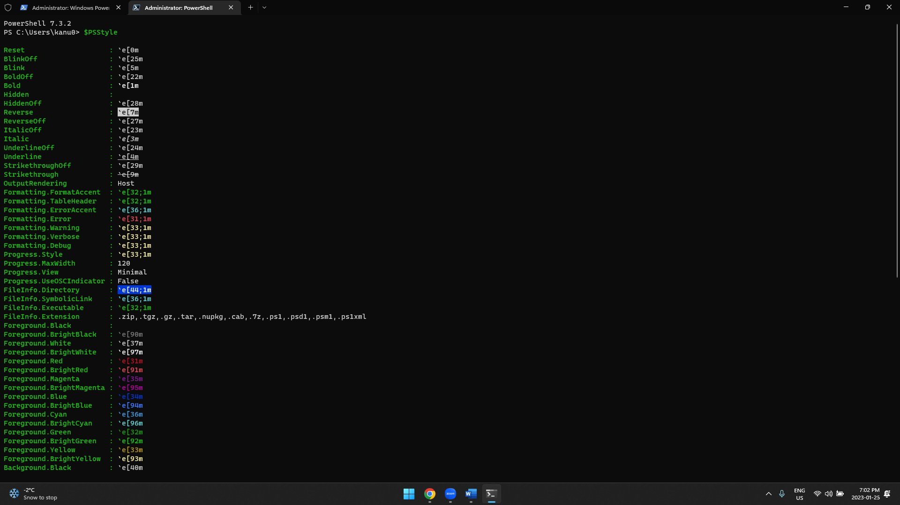
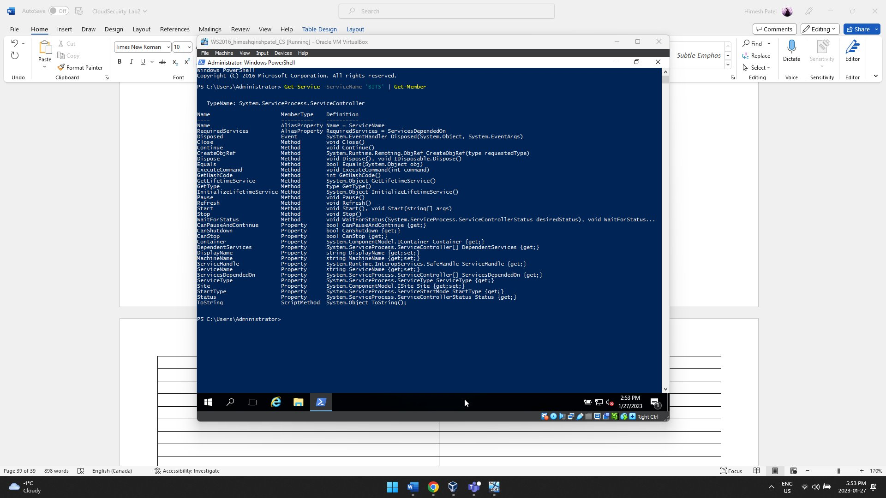
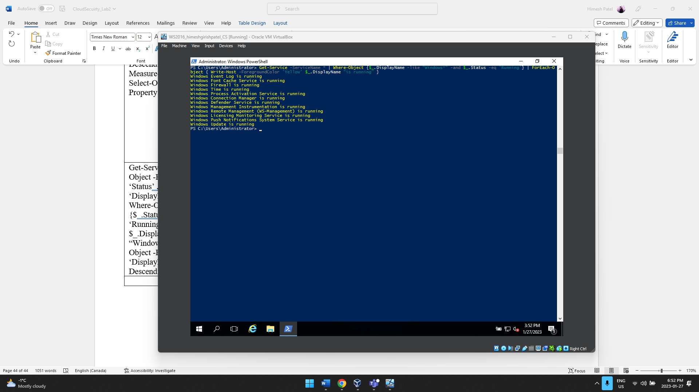
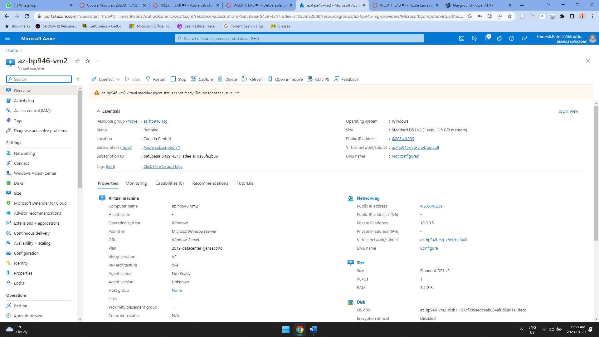

# Azure PowerShell and CLI Practice

## Overview
This guided lab focused on becoming more comfortable with PowerShell and command-line administration used with Azure. The assignment involved PowerShell 7, Azure PowerShell modules, Azure CLI, and related command-line tooling.

## Technologies Used
- PowerShell 7
- Az.Accounts / Az.Compute
- Azure CLI
- Microsoft Azure
- Bash / Git / WSL tooling used during the lab

## What I Did
- Worked through PowerShell exercises to become familiar with commands, objects, modules, and command output.
- Used Azure-related PowerShell tooling and command-line workflows.
- Worked with Azure resources while practicing command-line administration.
- Troubleshot issues encountered during the exercises and completed the lab using the required tooling.

## Selected Evidence
The original assignment contained many step-by-step screenshots. I kept only a small selection here to show the command-line work and Azure environment without duplicating every exercise.

## Environment Note
The Azure resources used for this lab were temporary coursework resources and are no longer running to avoid ongoing cloud charges.
