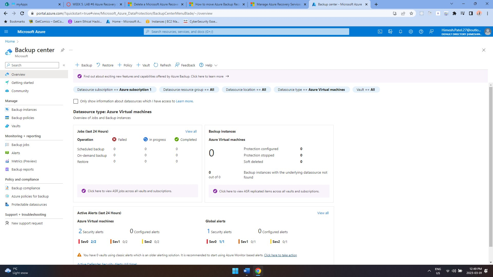
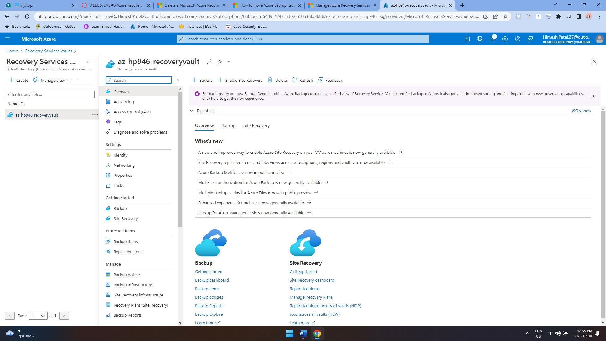
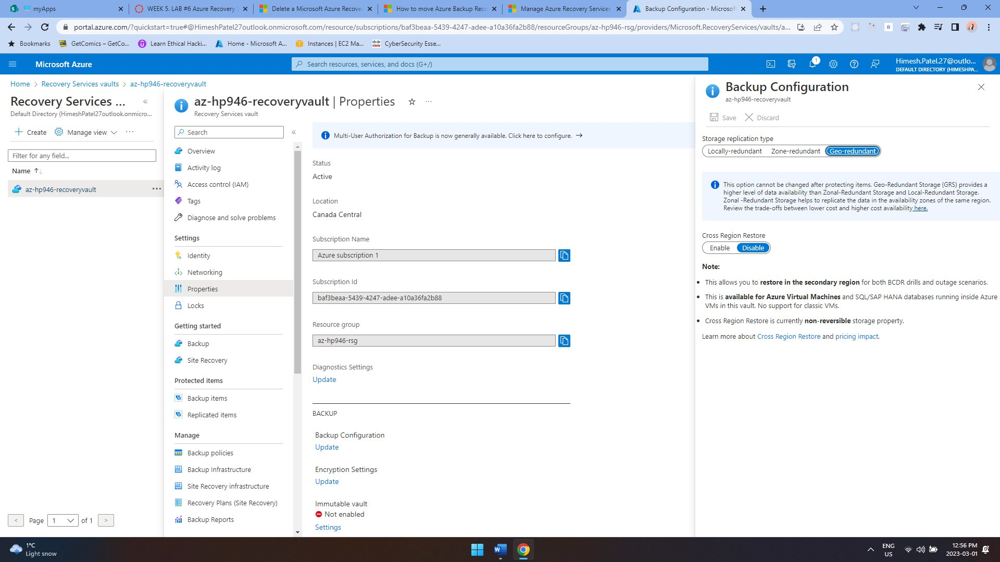
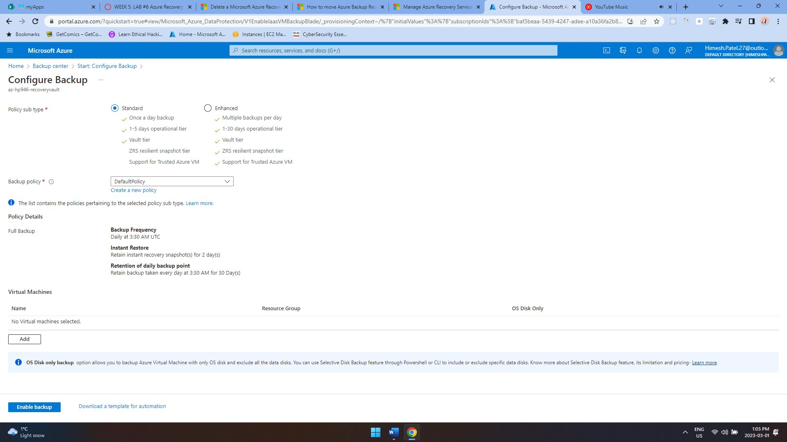
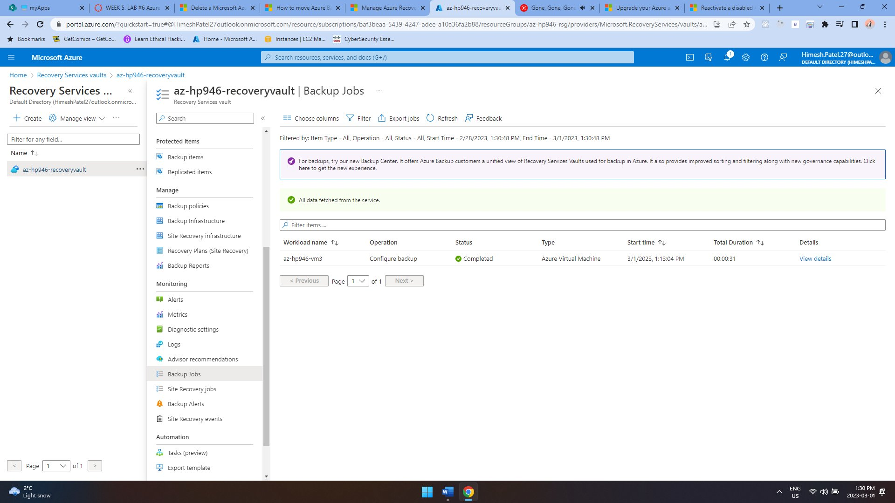
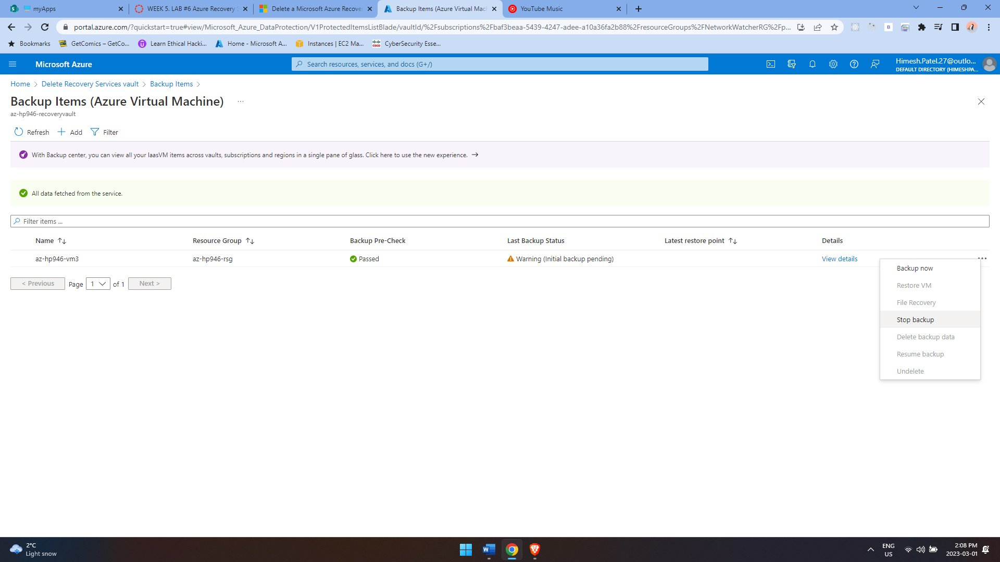

# Azure Recovery Services and Backup

## Overview
This guided college lab focused on Azure Recovery Services and backup administration. I created and configured a Recovery Services vault, worked with backup settings, and practiced managing the vault through the Azure portal.

## Technologies Used
- Microsoft Azure
- Recovery Services Vault
- Azure Backup

## What I Did
- Created and configured a Recovery Services vault.
- Worked with Azure Backup configuration and management.
- Reviewed backup items and vault status through the Azure portal.
- Practiced Recovery Services vault management, including the lifecycle tasks covered by the assignment.

## Evidence

## Environment Note
The Azure resources used for this lab were temporary coursework resources and were decommissioned after completion to avoid ongoing charges.
