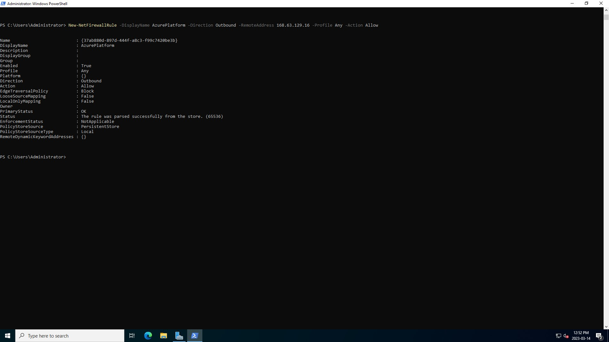
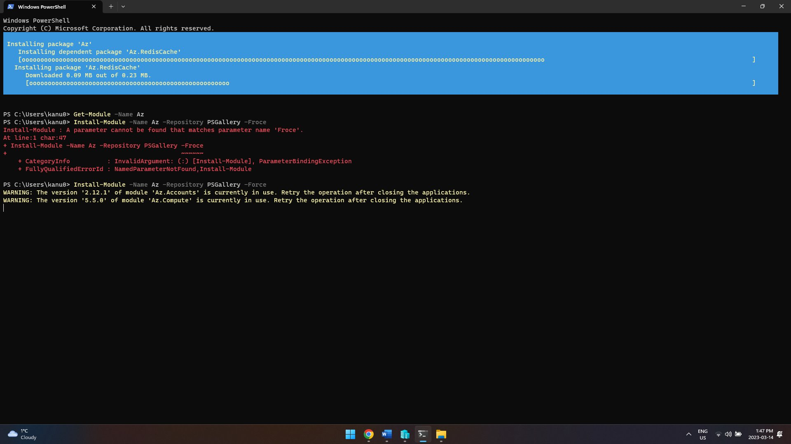
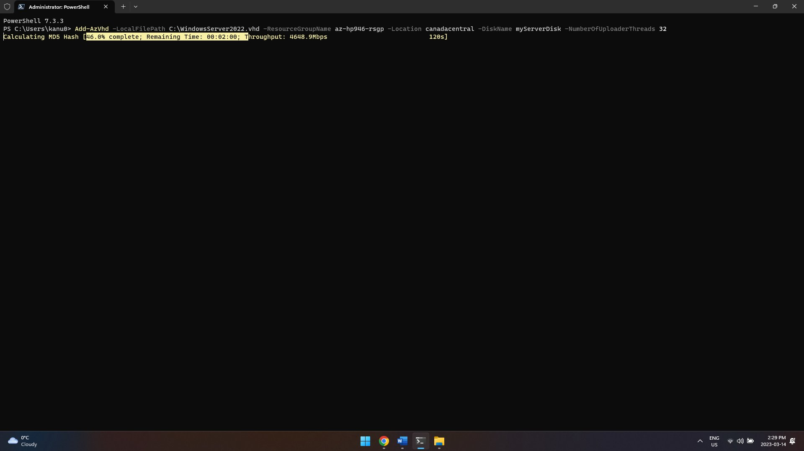
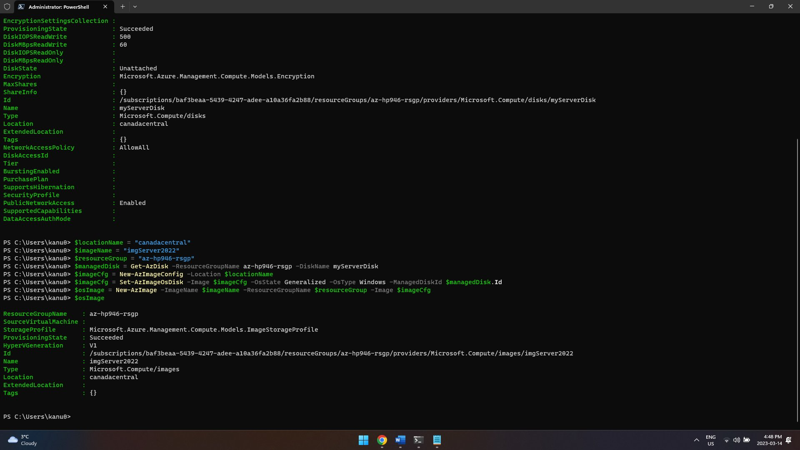
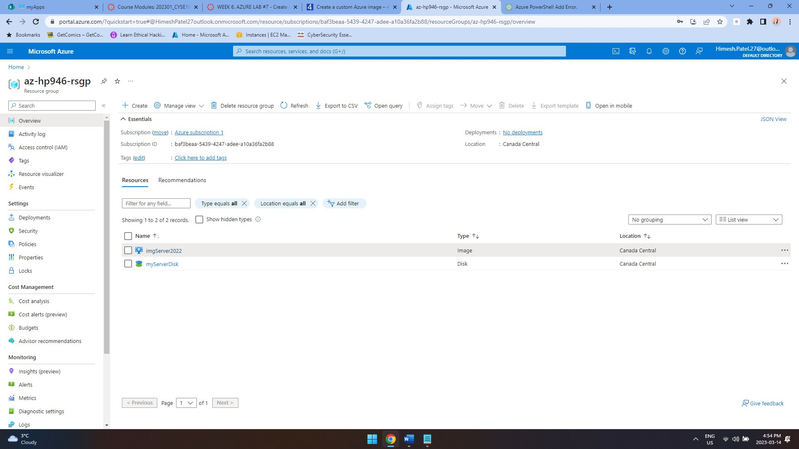
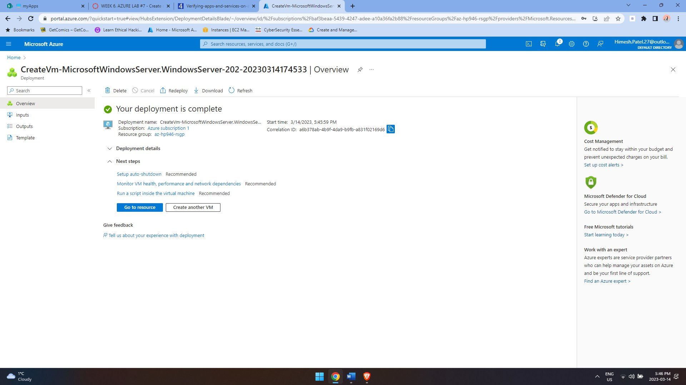

# Azure Custom VM Image with PowerShell

## Overview
This guided lab focused on preparing a Windows Server virtual machine and using PowerShell/Azure tooling as part of a reusable custom VM image workflow.

## Technologies Used
- Microsoft Azure
- Az PowerShell
- Windows Server
- Hyper-V
- IIS
- PowerShell Core

## What I Did
- Prepared a Windows Server VM for the custom-image workflow.
- Used PowerShell while working through VM and Azure resource preparation.
- Worked through the image generalization/upload process described in the assignment.
- Created the Azure image resource and used it as part of the VM deployment workflow.

## Evidence

## Environment Note
The Azure resources used for this lab were temporary coursework resources and are no longer running. The screenshots document the environment while the lab was being completed.
